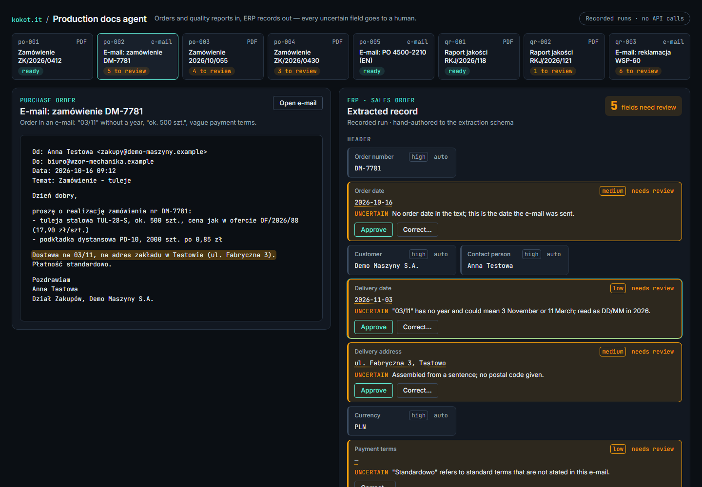
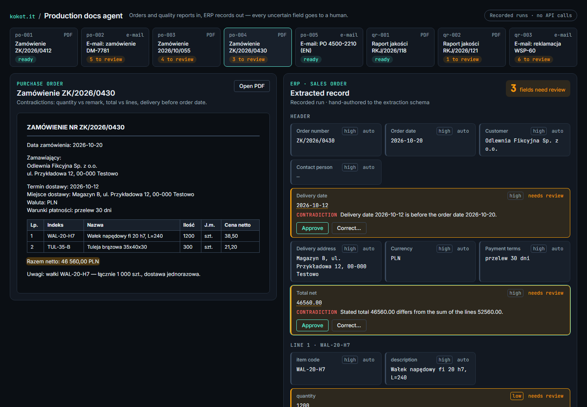
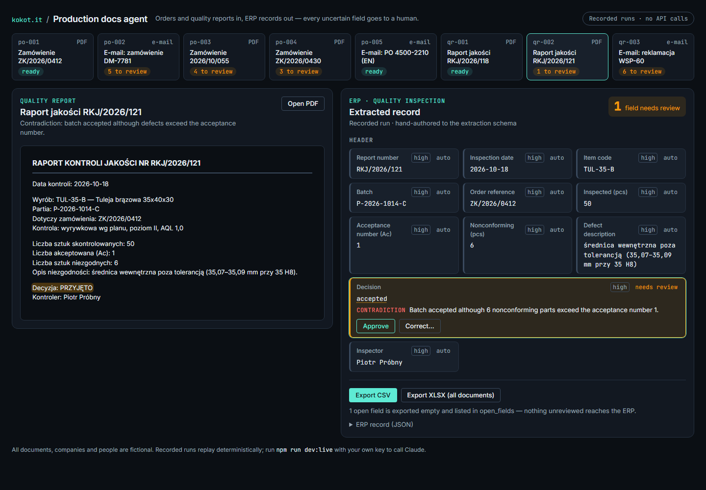
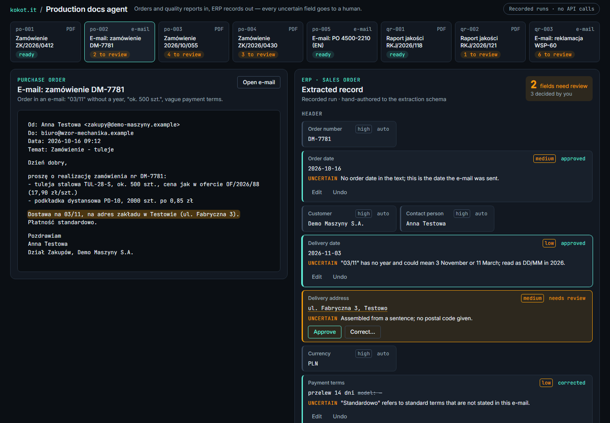
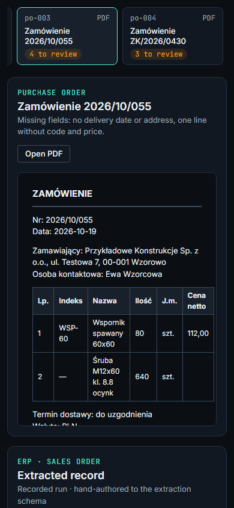

# Production docs agent

An AI agent that reads production documents — purchase orders and quality inspection reports, as
PDFs or e-mails — and turns them into spreadsheet rows and simple ERP records. Every value it is
not sure about goes to a human instead of being guessed.

> **PL —** Demo dla małych i średnich firm produkcyjnych: agent czyta zamówienia i raporty
> jakości (PDF, e-mail) i uzupełnia z nich arkusz / rekordy ERP. Pola niepewne, brakujące lub
> sprzeczne nie są zgadywane — trafiają do człowieka z podanym powodem, a do eksportu idą puste
> do czasu decyzji. Demo działa bez klucza API (nagrane przebiegi); z własnym kluczem w `.env`
> można uruchomić prawdziwą ekstrakcję przez Claude. Wszystkie dokumenty, firmy i osoby są
> fikcyjne.

## The problem

In a small manufacturing company someone retypes orders and inspection results from PDFs and
e-mails into a spreadsheet or the ERP. It is slow, and the expensive mistakes are the quiet ones:
a delivery date read the wrong way round, an approximate quantity typed as exact, a batch accepted
although the report itself says it failed. An extraction model removes the typing; it must not
remove the doubt. This demo shows the pattern: **extract → re-check deterministically → a human
decides what was uncertain → export only what is resolved.**

## Demo

| Uncertain e-mail order (`03/11`, "ok. 500 szt.")                       | Contradictions inside one order                                                   |
| ---------------------------------------------------------------------- | --------------------------------------------------------------------------------- |
|  |  |

| Quality report accepted against its own numbers                             | Human approves and corrects                                     |
| --------------------------------------------------------------------------- | --------------------------------------------------------------- |
|  |  |

Embedded, narrow screen (`?embed=1`):



The document is on the left, the extracted record on the right. Selecting a field highlights the
line it was read from. Flagged fields show why (missing, uncertain, invalid, not in the document,
contradiction); the reviewer can **Approve** the proposed value or **Correct** it. Export:

- **CSV** — the current document as rows (one per order line), UTF-8 with BOM for Excel.
- **XLSX** — all documents: `orders`, `quality`, and a `review_log` of every decision.
- **ERP record (JSON)** — the record a simple ERP import would receive.

Unresolved fields are exported **empty** and listed in `open_fields`, with
`review_status = needs_review`.

### Demo documents

Eight fictional documents in [`documents/`](documents) (source text) and
[`public/documents/`](public/documents) (generated PDFs, e-mails as text). Companies and people
are invented; e-mail domains use the reserved `.example` TLD.

| id     | format      | what it tests                                                                                          |
| ------ | ----------- | ------------------------------------------------------------------------------------------------------ |
| po-001 | PDF         | clean order                                                                                            |
| po-002 | e-mail      | `03/11` without a year, "ok. 500 szt.", "płatność standardowo", order date only from the e-mail header |
| po-003 | PDF         | missing delivery date and address, a line without item code and price                                  |
| po-004 | PDF         | quantity 1200 vs remark "1 000 szt.", stated total ≠ sum of lines, delivery before order date          |
| po-005 | e-mail (EN) | clean order in EUR with dotted dates                                                                   |
| qr-001 | PDF         | clean inspection report                                                                                |
| qr-002 | PDF         | batch accepted with 6 defects where the acceptance number is 1                                         |
| qr-003 | e-mail      | complaint: no report or batch number, "kilkanaście" defects, no decision yet                           |

## Running it

Requires Node 22+ (developed on Node 24).

```bash
npm ci
npm run dev        # recorded mode: http://localhost:5173 — no key, no server, no API calls
npm run build      # static build in dist/ (relative paths, works from any sub-path)
npm run preview    # serve the static build
```

URL parameters: `?doc=po-004` opens a document, `?embed=1` hides the header and footer.

### Live mode (real Claude calls)

```bash
cp .env.example .env          # then set ANTHROPIC_API_KEY=...
npm run dev:live              # same UI with an "Extract with Claude" button
```

`dev:live` runs the Vite dev server with a small middleware (`POST /api/extract`) in the local
Node process. The key is read from `.env` there and never sent to the browser (it has no `VITE_`
prefix, so Vite does not expose it). The endpoint only accepts ids from the demo catalog.

Model: **`claude-opus-5-5`** (override with `CLAUDE_MODEL` in `.env`), called through the official
`@anthropic-ai/sdk` with structured output (`client.beta.messages.parse` +
`betaZodOutputFormat`, the same zod schema the recordings use), adaptive thinking, `effort: high`,
and server-side refusal fallback (`fallbacks: "default"`). PDFs are sent as base64 `document`
blocks, e-mails as plain-text `document` blocks.

### Recording new runs

```bash
npm run record              # all documents → recordings/<id>.json
npm run record -- po-002    # selected documents
npm test                    # the corpus test shows which flags changed
```

The committed recordings are **hand-authored** to the extraction schema (marked
`"source": "hand-authored"`), because no API key was available while building the demo. A
recorded live run is marked `"source": "live"` with the model and timestamp. Recordings are stored
canonically and replayed without any randomness, so the demo is deterministic.

### Scripts

| script              | what it does                                                                 |
| ------------------- | ---------------------------------------------------------------------------- |
| `dev`, `dev:live`   | dev server, recorded or live mode                                            |
| `build`, `preview`  | static build and preview                                                     |
| `test`              | Vitest (domain rules, mapping, export, corpus replay, live request building) |
| `lint`, `typecheck` | ESLint + Prettier check, `tsc --noEmit`                                      |
| `record`            | record live extractions (needs a key)                                        |
| `docs:generate`     | regenerate the demo PDFs from `documents/*.txt` (Playwright Chromium)        |
| `screenshots`       | regenerate `docs/screenshots/` from the static build                         |

`docs:generate` and `screenshots` need `npx playwright install chromium` once.

## Architecture

```
documents/*.txt ──► scripts/generate-documents.ts ──► public/documents/*.pdf
                                                          │
            live: Claude (structured output) ◄────────────┘
                         │
recordings/*.json ◄──────┘ (npm run record)        recorded mode reads these
        │
        ▼
 domain/schema.ts      zod schema: every field = { value, confidence, source_text, note }
 domain/review.ts      deterministic checks → issues per field (never fills a value)
 domain/decisions.ts   human approve / correct → resolved values (flagged + undecided = null)
 domain/mapping.ts     resolved values → ERP records (JSON) → sheet rows
 domain/export.ts      CSV (RFC 4180, formula-injection safe) and XLSX (SheetJS)
 ui/                   vanilla TS + DOM; styles/tokens.css holds every brand value
 live/                 request builder, extractor, /api/extract handler, Vite plugin (Node only)
```

Review rules, applied to the model output whatever confidence it claims:

- a required field without a value → **missing**; an optional field the document mentions but the
  model could not resolve → **uncertain**;
- confidence below `high` → **uncertain**, with the model's reason;
- dates must be real `YYYY-MM-DD` dates, quantities in pieces whole and positive, prices ≥ 0 →
  **invalid**;
- the quoted `source_text` must occur in the document (case, whitespace and table pipes ignored) →
  otherwise **not in document** (a cheap hallucination check);
- cross-field: delivery before order date, stated total ≠ sum of lines (±0.005), more defects than
  parts inspected, "accepted" with defects above the acceptance number → **contradiction**.

## Embedding (kokot.it case study)

Deploy `dist/` under any path (it uses relative URLs), then:

```html
<iframe
  src="/demos/production-docs-agent/?embed=1&doc=po-002"
  title="Production docs agent — demo"
  style="width: 100%; height: 900px; border: 0"
  sandbox="allow-scripts allow-downloads allow-popups"
  loading="lazy"
></iframe>
<script>
  // Optional: size the iframe to its content.
  addEventListener('message', (e) => {
    if (e.data?.type === 'production-docs-agent:height') {
      document.querySelector('iframe[title^="Production docs agent"]').style.height =
        `${e.data.height}px`;
    }
  });
</script>
```

`allow-downloads` is needed for the CSV/XLSX export, `allow-popups` for "Open PDF". Fonts come
from Google Fonts; all colours, fonts and spacing are CSS custom properties in
[`src/styles/tokens.css`](src/styles/tokens.css), so the site's brand can replace them in one
file.

## Limitations

- The committed runs are hand-authored, not recorded from the API; they show the intended output,
  not measured model accuracy. Record real runs with `npm run record` before quoting numbers.
- The document type (order vs quality report) comes from the demo catalog; there is no classifier
  step and no upload of arbitrary files.
- Scanned documents and images are not covered; the PDFs are text PDFs.
- Rules are deliberately simple (no customer master data, no price lists, no unit conversion,
  no NIP/VAT validation) — the point is the review pattern, not a full ERP integration.
- "ERP" is a plain JSON record and spreadsheet rows; no real ERP is called.
- Human decisions live in memory and are lost on reload.
