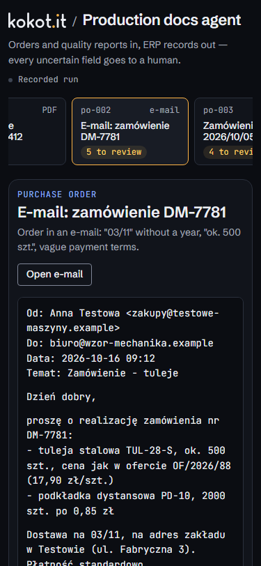
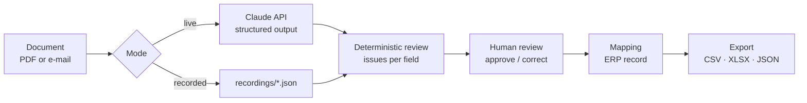

# Production docs agent

[](https://github.com/Aberratio/production-docs-agent/actions/workflows/ci.yml)
[](LICENSE)

An AI agent that reads production documents (purchase orders and quality inspection reports,
as PDFs or e-mails) and turns them into spreadsheet rows and ERP records. Every value it is not
sure about goes to a human instead of being guessed.

Built for small and mid-sized manufacturers whose orders and inspection results are still
retyped by hand, and for teams designing human-in-the-loop extraction with Claude.


> **PL:** Agent dla małych i średnich firm produkcyjnych: czyta zamówienia i raporty jakości
> (PDF, e-mail) i uzupełnia z nich arkusz oraz rekordy ERP. Pola niepewne, brakujące lub
> sprzeczne nie są zgadywane: trafiają do człowieka z podanym powodem, a do eksportu idą puste do
> czasu decyzji. Działa bez klucza API (zapisany przebieg) lub na żywo przez Claude API z kluczem
> w `.env`. Wszystkie dokumenty i firmy są fikcyjne.

## Why

Someone in a small plant retypes orders and inspection results from PDFs and e-mails into a
spreadsheet or the ERP. It is slow, and the expensive mistakes are the quiet ones: a delivery
date read the wrong way round, an approximate quantity typed as exact, a batch accepted although
the report itself says it failed. An extraction model removes the typing; it must not remove the
doubt. The pattern here: **extract → re-check deterministically → a human decides what was
uncertain → export only what is resolved.**

## Features

- **Structured extraction with Claude.** One call per document, validated against a zod schema;
  every field carries a value, a confidence, the quoted source text and a note.
- **Deterministic review on top of the model.** Missing, uncertain, invalid, not-in-document and
  contradictory fields are flagged by rules, whatever confidence the model claims.
- **Source highlighting.** Selecting a field highlights the line it was read from.
- **Human in the loop.** The reviewer approves or corrects each flagged value; corrections are
  validated and re-checked against the other fields.
- **Safe export.** CSV (UTF-8 with BOM, formula-injection safe), XLSX with `orders`, `quality` and
  a `review_log`, and an ERP record as JSON. Unresolved fields are exported **empty** and listed in
  `open_fields`.
- **Two modes.** A recorded run (deterministic, no key, no cost) and live extraction through the
  Claude API with the key kept on the server side.
- **Embeddable.** `?embed=1` renders a compact view for an iframe and reports its height to the
  host page.

| Contradictions inside one order                                                   | Quality report accepted against its own numbers                             |
| --------------------------------------------------------------------------------- | --------------------------------------------------------------------------- |
|  |  |

| Human approves and corrects                                     | Phone                                                                       | Embedded on a phone                                                                  |
| --------------------------------------------------------------- | --------------------------------------------------------------------------- | ------------------------------------------------------------------------------------ |
|  |  |  |

## Architecture



| module                 | responsibility                                                        |
| ---------------------- | --------------------------------------------------------------------- |
| `src/domain/schema`    | zod schema: every field is `{ value, confidence, source_text, note }` |
| `src/domain/review`    | deterministic checks, issues per field; never fills a value           |
| `src/domain/decisions` | approve / correct → resolved values (flagged and undecided = empty)   |
| `src/domain/mapping`   | resolved values → ERP record → sheet rows                             |
| `src/domain/export`    | CSV (RFC 4180) and XLSX (SheetJS)                                     |
| `src/live`             | request builder, extractor, `/api/extract` handler (Node only)        |
| `src/ui`               | vanilla TypeScript + DOM, kokot.it brand tokens                       |

Design decisions and trade-offs: [docs/architecture.md](docs/architecture.md).

### Review rules

- a required field without a value → **missing**; an optional field the document mentions but
  that could not be resolved → **uncertain**;
- confidence below `high` → **uncertain**, with the model's reason;
- the quoted source is re-read: a date without a year (`03/11`) or with swappable day and month,
  or an approximate count ("ok. 500", "kilkanaście", "~10") → **uncertain**;
- dates must be real `YYYY-MM-DD` dates, quantities in pieces whole and positive, prices ≥ 0 →
  **invalid**;
- every value needs a quoted `source_text` that occurs in the document → otherwise **not in
  document** (a cheap hallucination check);
- cross-field: delivery before order date, stated total ≠ sum of lines, more defects than parts
  inspected, "accepted" with defects above the acceptance number → **contradiction**. These run
  again on human-resolved values, so a correction cannot quietly contradict another field.

## Quick start

Requires Node 22+ (developed on Node 24).

```bash
npm ci
npm run dev          # recorded run: http://localhost:5173, no key, no API calls
```

### Live mode (Claude API)

```bash
cp .env.example .env # then set ANTHROPIC_API_KEY
npm run dev:live     # same UI with an "Extract with Claude" button
```

### Build

```bash
npm run build        # static build in dist/ (relative paths, works from any sub-path)
npm run preview      # serve the static build
```

URL parameters: `?doc=po-004` opens a document, `?embed=1` hides the header for an iframe.

## Configuration

| variable            | required       | default           | used by                              |
| ------------------- | -------------- | ----------------- | ------------------------------------ |
| `ANTHROPIC_API_KEY` | live mode only | none              | `npm run dev:live`, `npm run record` |
| `CLAUDE_MODEL`      | no             | `claude-opus-5-5` | live extraction and recording        |

Both are read from `.env` by the local Node process only. The recorded run needs no
configuration.

## Data

All documents, companies, people, addresses and numbers are **fictional**, created for this
project. Suppliers and customers do not exist; e-mail domains use the reserved `.example` TLD.
The UI marks this in its footer ("Sample data · fictional companies").

The eight sample documents live in [`documents/`](documents) (source text) and
[`public/documents/`](public/documents) (generated PDFs, e-mails as text):

| id     | format      | what it exercises                                                                                      |
| ------ | ----------- | ------------------------------------------------------------------------------------------------------ |
| po-001 | PDF         | clean order                                                                                            |
| po-002 | e-mail      | `03/11` without a year, "ok. 500 szt.", "płatność standardowo", order date only from the e-mail header |
| po-003 | PDF         | missing delivery date and address, a line without item code and price                                  |
| po-004 | PDF         | quantity 1200 vs remark "1 000 szt.", stated total ≠ sum of lines, delivery before order date          |
| po-005 | e-mail (EN) | clean order in EUR with dotted dates                                                                   |
| qr-001 | PDF         | clean inspection report                                                                                |
| qr-002 | PDF         | batch accepted with 6 defects where the acceptance number is 1                                         |
| qr-003 | e-mail      | complaint: no report or batch number, "kilkanaście" defects, no decision yet                           |

The committed recordings are **hand-authored** to the extraction schema
(`"source": "hand-authored"`): they show the intended output, not measured model accuracy.
Replace them with real runs before quoting numbers:

```bash
npm run record              # all documents → recordings/<id>.json (needs a key)
npm run record -- po-002    # selected documents
npm test                    # the corpus test shows which flags changed
```

## Tests and quality

| command                 | what it checks                                                                                                          |
| ----------------------- | ----------------------------------------------------------------------------------------------------------------------- |
| `npm test`              | 258 unit tests (Vitest): review rules, decisions, mapping, export, corpus replay, live endpoint, brand tokens, contrast |
| `npm run test:e2e`      | 12 browser tests (Playwright, Chromium) against the static build: review flow, exports, embedding                       |
| `npm run lint`          | ESLint + Prettier                                                                                                       |
| `npm run typecheck`     | `tsc --noEmit` (strict)                                                                                                 |
| `npm run check:wording` | scans the build, PDFs, documents and docs for wording that must not ship                                                |

CI runs all of them on every push and pull request. `test:e2e`, `docs:generate` and `screenshots`
need `npx playwright install chromium` once.

Other scripts: `npm run docs:generate` regenerates the PDFs from `documents/*.txt`;
`npm run screenshots` refreshes `docs/screenshots/` from the static build.

## Security

- **The API key stays on the server side.** It is read from `.env` by the local Node process and
  never shipped to the browser: it has no `VITE_` prefix, so Vite does not expose it, and an e2e
  test asserts the built assets contain no key material and no SDK code.
- `/api/extract` accepts only document ids from the sample catalog, only `application/json`
  bodies, and only requests whose `Origin` is the dev server itself, so another web page open in
  your browser cannot spend your credits.
- Exports neutralise spreadsheet formula injection; the document view escapes all document text.

## Embedding

Deploy `dist/` under any path (it uses relative URLs), then:

```html
<iframe
  src="/tools/production-docs-agent/?embed=1&doc=po-002"
  title="Production docs agent"
  style="width: 100%; height: 900px; border: 0"
  sandbox="allow-scripts allow-same-origin allow-downloads allow-popups"
  loading="lazy"
></iframe>
<script>
  // Optional: size the iframe to its content.
  addEventListener('message', (e) => {
    if (e.origin === location.origin && e.data?.type === 'production-docs-agent:height') {
      document.querySelector('iframe[title^="Production docs agent"]').style.height =
        `${e.data.height}px`;
    }
  });
</script>
```

`allow-same-origin` is required: without it the frame's origin is `null` and the browser blocks
Vite's `crossorigin` assets, leaving an empty frame. It is safe because the app is served from the
same host. `allow-downloads` enables export and `allow-popups` the "Open PDF" link. The e2e suite
embeds the build with exactly this sandbox attribute, read from this README.

## Limitations

- The document type comes from the sample catalog; there is no classifier and no upload of
  arbitrary files.
- Scanned documents and images are not covered; the PDFs are text PDFs.
- Rules are deliberately simple (no customer master data, price lists, unit conversion or VAT ID
  validation); the focus is the review pattern, not a full ERP integration.
- "ERP" is a JSON record plus spreadsheet rows; no real ERP is called.
- Human decisions live in memory and are lost on reload.
- Some flags rely on the model's own confidence rather than a deterministic rule (po-002's order
  date, delivery address and payment terms; po-004's quantity; qr-003's report date and
  inspector).
- The review checks that the quoted source exists, not that the value was read correctly from it.
- A contradiction stated only in prose (po-004's remark "łącznie 1 000 szt.") is caught only if
  the model reports it.

## License

[MIT](LICENSE) © 2026 Joanna Kokot

## Author

Built by [kokot.it](https://kokot.it): AI and agentic engineering for manufacturing companies
and software teams.
